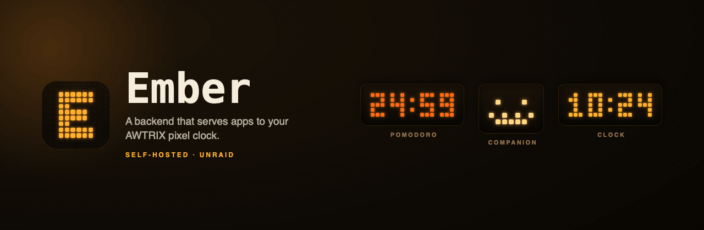

# Ember

Ember puts what your coding agents are doing on a desk display. A Mac menu-bar
app watches Claude Code, Codex and T3 Code, and an [AWTRIX NG](https://github.com/Blueforcer/awtrix-ng)
pixel clock (an Ulanzi TC001) shows whether each one is running, waiting for
your approval, done or failed, so you can look away from the terminal and still
know when it needs you. The same clock doubles as a Pomodoro timer and a small
dashboard for your calendar, weather, music and 3D printer.

Ember is free, open source (MIT) and runs entirely on your own network.

## What you need

- **A Mac on macOS 26.** The menu-bar app and the agent integrations run here.
- **An Ulanzi TC001 pixel clock running AWTRIX NG firmware.** See
  [`docs/HARDWARE.md`](docs/HARDWARE.md) for what is supported and how to flash it.
- **Claude Code and/or Codex** (T3 Code works too) on that Mac.

Ember needs a server, but you don't have to run one yourself: the app can host
it on your Mac.

## Install

> A notarized download is coming with [#835](https://github.com/tarakanof/ember/issues/835);
> it will replace the build steps below with a link. Until then, build the app
> yourself. These steps are for v0.90.0 and later.

1. Install the build tools: Xcode and `brew install xcodegen`.
2. Clone this repository and, from its root, run `scripts/build-local.sh`. It
   builds a Release `Ember.app` into `/tmp/ember-local-build/Build/Products/Release/`.
3. Copy it to `/Applications` (`ditto /tmp/ember-local-build/Build/Products/Release/Ember.app /Applications/Ember.app`)
   and open it. Allow **Local Network** access when macOS asks; Ember uses it to
   find the clock.
4. Open **Settings › Connection**. Choose **Run on this Mac** to have Ember host
   its own server, or **Use another server** to connect to one you already run
   (see "Running your own server" below).
5. Pick your clock in the **Device** tab.

[`docs/RUNBOOK.md`](docs/RUNBOOK.md) covers code signing for local builds,
installing the Claude Code plugin and the headless producers.

## What it shows

- **Agent status**: Claude Code, Codex and T3 Code sessions as running, waiting, done or error.
- **Usage**: how much of your Claude and Codex rate limits you have used, when it matters.
- **Pomodoro**: a focus timer with its own countdown and progress bar; the clock's buttons drive it.
- **Meetings**: your next calendar events.
- **Weather**: current conditions from a provider you configure.
- **Now playing**: what Plex or Apple Music is playing.
- **3D printer**: job progress from a Prusa printer over PrusaLink.

An optional round knob ([cinder](https://github.com/tarakanof/cinder)) shows the
same data on a small screen. See [`docs/HARDWARE.md`](docs/HARDWARE.md).

## Scope

Ember stays small on purpose. It targets AWTRIX NG clocks and won't add other
display families, nor more integrations of the weather, printer or media kind.
To show something else, send it in: give your script or automation a scoped
`ingest` token and post to the HTTP API. See "Integrating a source" in
[`docs/RUNBOOK.md`](docs/RUNBOOK.md#integrating-a-source) and the
[OpenAPI contract](docs/openapi.yaml).

## Running your own server (advanced)

The server is one Go binary and a small distroless Docker image
(`dtarakanov/ember`). Run it in Docker, on Unraid, or as a per-user service, and
point the app at it with **Use another server**. Producers on Linux machines
report to it without the app. See [`docs/RUNBOOK.md`](docs/RUNBOOK.md): "Unraid
install and Docker operations", "Running the server without Docker" and
"Headless / Linux producers".

## Docs

- [`docs/HARDWARE.md`](docs/HARDWARE.md): supported clocks and the firmware licence
- [`docs/RUNBOOK.md`](docs/RUNBOOK.md): build, deploy, install, configuration
- [`docs/API.md`](docs/API.md) and [`docs/openapi.yaml`](docs/openapi.yaml): the HTTP API
- [`docs/ARCHITECTURE.md`](docs/ARCHITECTURE.md): how it works
- [`docs/DEVICE-PROTOCOL.md`](docs/DEVICE-PROTOCOL.md): the knob contract
- [`CONTRIBUTING.md`](CONTRIBUTING.md) and [`SECURITY.md`](SECURITY.md)

## Licence

MIT, see [`LICENSE`](LICENSE). Ember is an independent project, not affiliated
with or endorsed by Ulanzi or the AWTRIX firmware authors. The AWTRIX NG
firmware is source-available under PolyForm Noncommercial; Ember talks to it
over HTTP and ships none of it.
